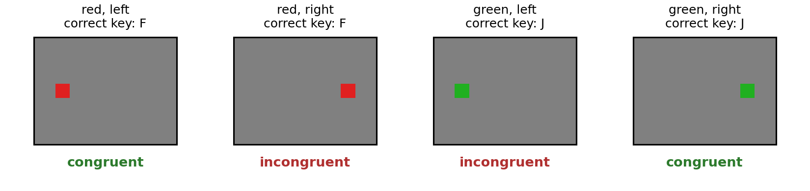
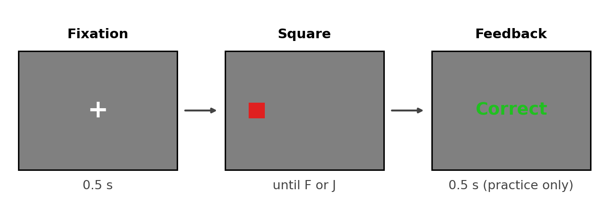
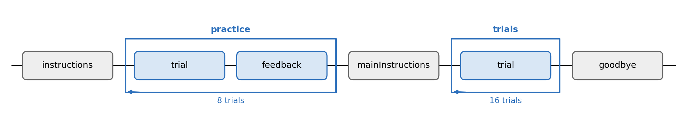

# Experiment 1 · Simon task

Allow about **18 minutes**. Open `exp code/simon.psyexp` in PsychoPy Builder.
The Flow is ready, but `trial` contains only the fixation cross. You will
add the square and response Keyboard yourself. Run only a few practice
trials in class.

## 1. What is this experiment about?

A square appears on the left or right. It is red or green. Press **F** for
red and **J** for green. The square's position does not tell you which key
is correct, but it may still affect how quickly you respond. A red square
on the left is *congruent*: its position matches the side of the F key.

### Design

There are four trial types: 2 colours × 2 positions. Practice shows each
type twice (**8 trials**) and gives feedback. The main block shows each
type four times (**16 trials**) without feedback. Each trial has a 0.5 s
fixation cross, then a square that stays until you press F or J. We record
accuracy and reaction time. The prediction is that correct responses will
be slower on incongruent trials.

The diagram shows the configured Flow. You will build the square and
response components inside `trial`.

## 2. Your Builder TODOs

Save the file as you work. Fill the CSV and Builder blanks before **Run**.

### 1 — Look at the conditions

Open `exp code/conditions.csv`. Each row is one trial type. Find the four
columns: `colour`, `xPos`, `congruency` and `correctAns`. A negative `xPos`
means left; a positive value means right. Fill all four `____` cells,
then save the CSV without changing its column names. Hint: compare each
square's side with the side of its correct key; the correct key depends
only on colour.

In Builder's Flow, find `practice` around `trial → feedback` and `trials`
around `trial` alone. The loops already use `conditions.csv` and have
**nReps** 2 and 4, giving 8 practice and 16 main trials.

### 2 — Add the square

In `trial`, add a **Polygon** component named `square`. Set Start to
`0.5`, leave Stop empty, choose Shape `rectangle`, and set Size to
`(0.1, 0.1)`. The square should begin as the fixation ends.

On *Layout*, set Position to `(____, 0)` and choose **set every repeat**.
Hint: use the column that gives the horizontal position. Do not type `$`
in this field.

On *Appearance*, set both **Fill colour** and **Border colour** to
`$____`. Choose **set every repeat** for each. Hint: use the colour column.

### 3 — Add and score the response

In `trial`, add a **Keyboard** component named `response`. Set Start to
`0.5`, leave Stop empty, set Allowed keys to `'f', 'j'`, and tick
**Force end of Routine**. On *Data*, set **Store** to `first key`, tick
**Store correct**, and set **Correct answer** to `$____`. Hint: the
`correctAns` column holds `f` or `j` for each row.

### 4 — Short check

Save and click **Run**. Press SPACE at the opening screen. The Flow has
**8 practice + 16 main = 24 trials**. In class, run just enough to check
the task, then press Escape. The
square's position and colour should follow the current CSV row. F should
be correct for red and J for green.

Open the newest CSV in `exp code/data/`. Check `colour`, `xPos`,
`response.keys` and `response.corr`. A correct response has `1` in
`response.corr`; an incorrect one has `0`.

## 3. Think about it

1. Which information decides the correct key: colour or position?
2. Why might an irrelevant position still affect reaction time?
3. What creates the conflict in Stroop, and what creates it here?
