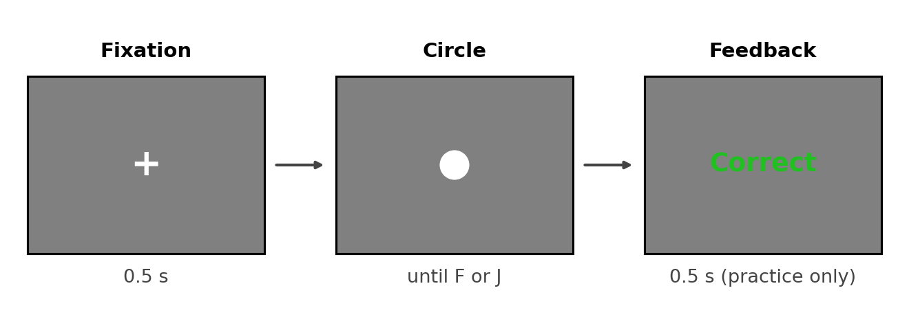
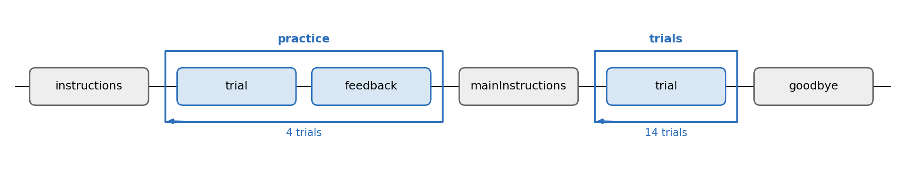

# Experiment 2 · Size bisection

Allow about **14 minutes**. Open `exp code/size_bisection.psyexp` in Builder.
You will make a circle's size follow the conditions file and add the
response Keyboard. The Flow, instructions and feedback are ready.

## 1. What is this experiment about?

Learn two reference circles: **small** (diameter `0.06`) and **large**
(diameter `0.12`). For each circle, press **F** if it looks more like the
small reference or **J** if it looks more like the large one.

### Design

Practice uses only the two references: 2 sizes × 2 repeats = **4 trials**
with feedback. The main block uses seven sizes × 2 repeats = **14 trials**
without feedback. Each trial has a 0.5 s fixation cross, then a circle
that stays until you respond. We compare the keys chosen at different
sizes. The five middle sizes have no single correct answer.

The diagram shows the configured Flow. `practice` uses `anchors.csv`;
`trials` uses
`conditions.csv`.

## 2. Your Builder TODOs

Save the files as you work. Complete the CSV and Builder blanks before
clicking **Run**.

### 1 — Check the two conditions files

Open `exp code/anchors.csv`: it contains only `0.06` and `0.12`. Fill its
two `____` correct keys. Hint: F is small and J is large.

Then open `exp code/conditions.csv`. It has seven `probeSize` values.
Fill the two `____` cells for the smallest and largest sizes. Leave the
five middle `correctAns` cells truly empty: those are **not** TODOs,
because a middle size has no single correct answer. Save both CSV files
without changing their column names.

Both `practice` and `trials` have **nReps** 2. The loops repeat the rows
in their conditions files.

### 2 — Make the circle vary

In `trial`, open **Polygon** `probe`. On *Layout*, replace its fixed Size
with `(____, ____)` and choose **set every repeat**. Hint: use `probeSize`
in both places, without `$`. Both dimensions must change together so the
shape remains a circle.

### 3 — Add and score the response

In `trial`, add a **Keyboard** component named `response`. Set Start to
`0.5`, leave Stop empty, set Allowed keys to `'f', 'j'`, and tick
**Force end of Routine**. On *Data*, set **Store** to `first key`, tick
**Store correct**, and set **Correct answer** to `$____`. Hint: use the
column containing `f` for small and `j` for large.

### 4 — Short check

Save and click **Run**. The Flow has **4 practice + 14 main = 18 trials**.
In class, check a few trials, then press Escape. In the newest CSV
in `exp code/data/`, check `probeSize` and `response.keys`.

The middle main-block sizes have no correct key. If you run them later,
ignore `response.corr` for those rows: a `0` there does **not** mean the
participant made an error. Use `response.keys` to study their choices.

## 3. Think about it

1. Why are the two reference sizes useful before judging middle sizes?
2. Which of the seven sizes would you expect to be hardest to classify?
3. Why should we not score a middle-size response as right or wrong?
