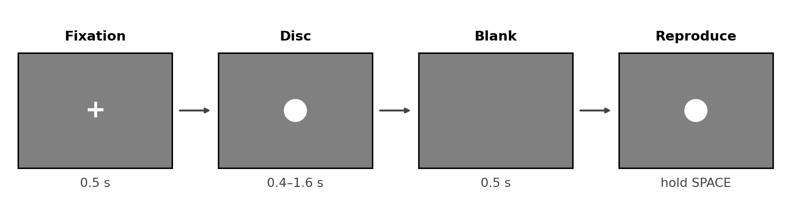
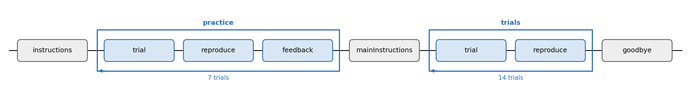

# Experiment 3 · Duration reproduction

Allow about **16 minutes**. Open `exp code/duration_reproduction.psyexp` in
Builder. The `trial` and `reproduce` Routines and full Flow are ready. You
will set the disc's duration, change how the Keyboard records SPACE and
add a short Code component to draw while the key is held.

## 1. What is this experiment about?

Watch a white disc. When it disappears, wait for “Hold SPACE”, then hold
SPACE for as long as the disc was visible. Release the key to finish. The
disc appears again while you hold it. Do not count in your head.

### Design

Seven target durations run from `0.4` to `1.6` seconds in `0.2`-second
steps. Practice shows each once (**7 trials**) with feedback; the main
block shows each twice (**14 trials**) without feedback. A trial
has 0.5 s of fixation, the target disc, 0.5 s of blank screen and then
the held-key response. We compare `stimDur` with `response.duration`.



In the Flow, both blocks contain `trial → reproduce`; only practice adds
`feedback`. The diagram shows the configured Flow.



## 2. Your Builder TODOs

Save as you work. Fill the CSV and complete the Builder changes before
running.

### 1 — Check the duration list

Open `exp code/conditions.csv`. Its seven rows list the `stimDur` values
from `0.4` to `1.6` seconds. Fill the two `____` cells so the values
increase by `0.2` seconds. Save the CSV without changing its column name.
Both loops use this file: `practice` has **nReps** 1 and `trials` has
**nReps** 2.

### 2 — Set the target duration

In `trial`, open **Polygon** `disc`. Its Stop is currently fixed at `1.0`.
Replace it with `$____` and leave the update menu at **constant**. Hint:
the blank is the name of the duration column. The `$` makes the Stop value
come from the current row.

### 3 — Measure a held key

In `reproduce`, open **Keyboard** `response`. On *Basic*, change
**Register keypress on** from `press` to `____`. Hint: to measure how long
SPACE was held, Builder must record the key when it is released.

### 4 — Add Code for the held disc

In `reproduce`, add a **Code** component named `showWhileHeld` **below**
`response` in the component list. Set Code Type to **Py**. On *Each Frame*,
enter this block and fill both blanks:

```python
if response.status == STARTED:
    if response.getKeys(keyList=['space'], waitRelease=____, clear=____):
        disc.draw()
```

Hint: use `False` for both. The first lets the Code see a key that is still
held; the second lets `response` record its release. Keep the indentation
shown, and leave the other Code tabs empty.

### 5 — Short check

Save and click **Run**. After the prompt appears, press and hold SPACE:
the disc should reappear. Release SPACE: the Routine should end. The
Flow has **7 practice + 14 main = 21 trials**.
In class, check one or two trials, then press Escape.

In the newest CSV in `exp code/data/`, find `stimDur` and
`response.duration`. If `response.duration` is empty, recheck the Keyboard
setting and the two Code blanks.

## 3. Think about it

1. Why does the Keyboard register on release rather than press?
2. What would happen if the disc stayed on screen after releasing SPACE?
3. Is a 0.2 s error equally important for a 0.4 s and a 1.6 s target?
