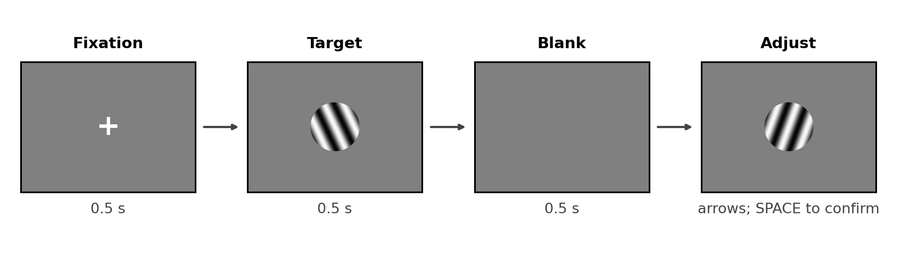
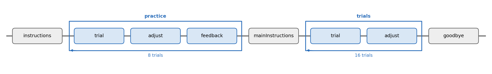

# Experiment 4 · Orientation reproduction

Allow about **17 minutes**. Open `exp code/orientation_reproduction.psyexp`
in Builder. The circular gratings and Flow are in place. You will connect the
target angle and complete two tabs of the rotation Code.

## 1. What is this experiment about?

Briefly view a circular grating, then rotate a second one until its stripes
match what you remember. Hold the left or right arrow key to rotate; press
SPACE to confirm.

### Design

There are eight target orientations: `0°`, `22.5°`, …, `157.5°`. Practice
shows each once (**8 trials**) with feedback; the main block shows each
twice (**16 trials**) without feedback. After 0.5 s of fixation, the
target appears for 0.5 s. A 0.5 s blank interval comes before adjustment.
We save `targetOri`, `reportedOri` and `oriError`.

The stripe direction repeats after **180°**, not 360°: `0°` and `180°`
look the same. Each stimulus uses `sin` stripes inside a fixed `circle`
mask. Only the stripe orientation changes; the circle stays in place.



Both blocks contain `trial → adjust`; only practice adds `feedback`. The
diagram shows the configured Flow.



## 2. Your Builder TODOs

Save as you work. Complete the CSV and Builder blanks before **Run**.

### 1 — Check the target list

Open `exp code/conditions.csv`. Its `targetOri` column contains eight
angles in `22.5°` steps. Fill the two `____` cells, then save the CSV
without changing the column name. Both loops use this file and have
**nReps** 1 for `practice` and 2 for `trials`.

### 2 — Vary the target

In `trial`, open **Grating** `target`. On *Layout*, replace the fixed
Orientation `0` with `____` and choose **set every repeat**. Hint: use the
angle column name without `$`. Leave Texture `sin` and Mask `circle` as
they are.

### 3 — Complete the rotation Code

In `adjust`, open **Code** `adjustProbe`. *Begin Experiment* already makes
an arrow-key Keyboard, and *Each Frame* already turns the probe. Replace
the TODO comment in *Begin Routine* with this block:

```python
probeOri = random() * ____
lastT = 0
adjustKb.clearEvents()
```

Replace the TODO comment in *End Routine* with this block:

```python
reportedOri = probeOri % ____
oriError = (reportedOri - targetOri + 90) % 180 - 90
thisExp.addData('reportedOri', reportedOri)
thisExp.addData('oriError', oriError)
```

Hint: use the number of degrees in one full cycle of a stripe orientation
for **both** blanks. The first block chooses a new start angle and resets
timing each trial. The second saves the reported angle and signed error.

### 4 — Short check

Save and run one or two practice trials. You should see a circular target,
a blank interval and a movable probe. Hold an arrow key to rotate the
probe; press SPACE to finish. The Flow has
**8 practice + 16 main = 24 trials**. In class, press Escape after you
have checked the task.

In the newest CSV in `exp code/data/`, check `targetOri`, `reportedOri`
and `oriError`. For example, a report of `175°` for a `0°` target is
`-5°` away, not `175°` away.

## 3. Think about it

1. Why are `0°` and `180°` the same orientation here?
2. Why should the probe start at a random angle?
3. Why does the Code use elapsed time (`dt`) while an arrow key is held?
