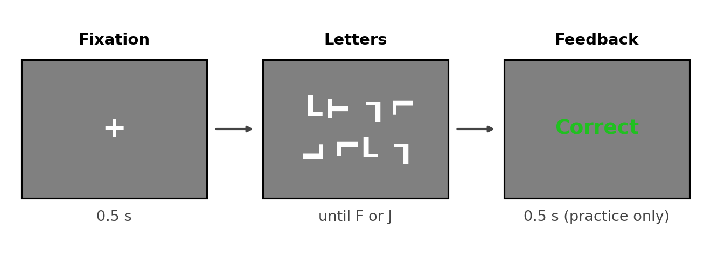

# Experiment 5 · Visual search

Allow about **17 minutes**. Open `exp code/visual_search.psyexp` in Builder.
The letter shapes and Flow are ready. You will make the display follow the
conditions file, finish the drawing Code and score the response.

## 1. What is this experiment about?

Find a **T** among rotated **L**s. Press **J** if a T is present and **F**
if it is absent. A display contains 4, 8, 12 or 16 letters.

### Design

Four set sizes × target present or absent gives eight trial types.
Practice shows each once (**8 trials**) with feedback; the main block
shows each twice (**16 trials**) without feedback. After a 0.5 s
fixation cross, the letters stay until you respond. We record accuracy
and reaction time to ask whether larger displays take longer to search.



The diagram shows the configured Flow. Only practice contains `feedback`.


## 2. Your Builder TODOs

This is a local Python experiment. The Code components are set to **Py**.
Save as you work; complete the CSV and Builder blanks before **Run**.

### 1 — Check the trial types

Open `exp code/conditions.csv`. It has `setSize`, `targetPresent` and
`correctAns`. Fill its four `____` cells in the last two rows. Hint: the
four set sizes are 4, 8, 12 and 16; `1` means a T is present and needs
`j`, while `0` means absent and needs `f`. Save the CSV without changing
the column names. Both loops use this file; `practice` has **nReps** 1
and `trials` has **nReps** 2.

### 2 — Complete the display Code

In `trial`, open **Code** `makeDisplay`. On *Begin Routine*, find
`for i in range(____):` and, a few lines below it,
`if i == 0 and targetPresent == ____:`. Fill the two blanks. Do not
replace the rest of the Code.

Hint: the first blank is the column telling you how many letters to draw;
the second is the number meaning “T present”.

### 3 — Score the answer

Open **Keyboard** `response` in `trial`. On *Data*, tick **Store correct**
and set **Correct answer** to `$____`. Hint: the column contains `f` or
`j` for the current trial.

### 4 — Draw the letters on each frame

In `makeDisplay`, open *Each Frame*. Replace the TODO comment with:

```python
if fixation.status == FINISHED:
    for item in items:
        item.draw()
```

Keep the indentation shown. This starts drawing after the fixation cross
and keeps the letters visible until the response ends the Routine.

### 5 — Short check

Save and run a few practice trials. Compare each display with its
`setSize` and `targetPresent` row; a short random sample may not show
every trial type. The Flow has **8 practice + 16 main = 24 trials**.
In class, press Escape after you have checked the task.

In the newest CSV in `exp code/data/`, check `setSize`, `targetPresent`,
`response.keys` and `response.corr`. If you see an empty screen after the
cross, check the two Code blanks and that the *Each Frame* tab still
contains the drawing code.

## 3. Think about it

1. Why might a display with 16 letters take longer than one with 4?
2. Why might deciding “no T is present” be slower than finding one T?
3. Why must the letters be drawn on *Each Frame* until the response?
